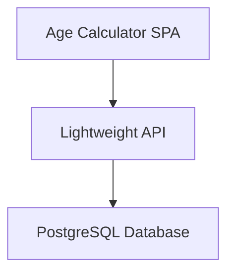
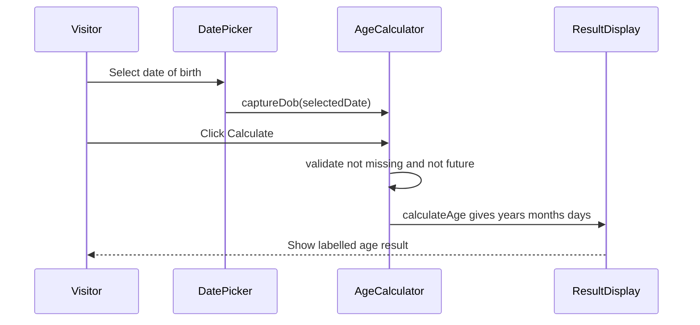
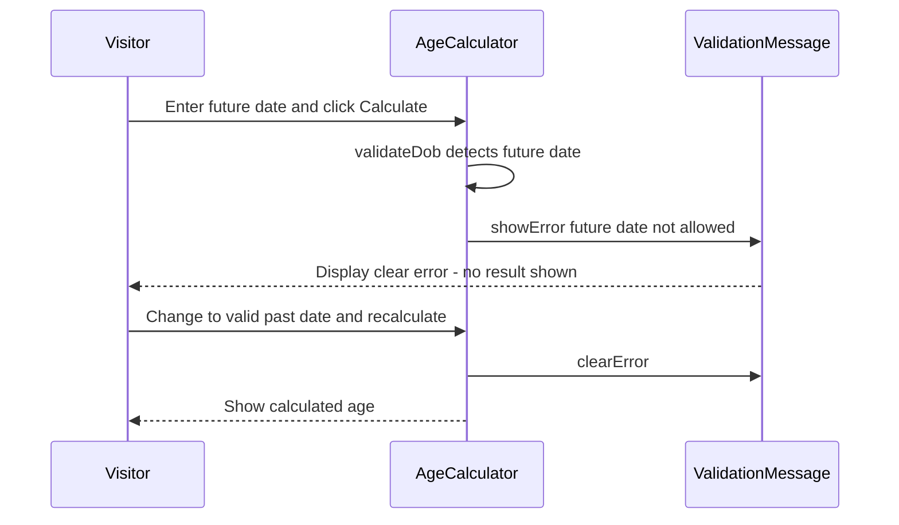

# Architecture

> Maintained by QuorQ AI SDLC. Text between `sdlc:auto` markers is regenerated; anything outside them is yours and is kept.

<!-- sdlc:auto:start narrative -->
## Overview

### ARCH-OVERVIEW · approved · source: architecture:summary

Approved v1 architecture: a free, anonymous, client-side age calculator built as a React 19 SPA with a minimal FastAPI backend and an empty PostgreSQL 16 database held for future use.

The system computes age in complete years, months and days entirely in the visitor's browser against the current date, after the visitor picks a date of birth via a date picker. Future dates are rejected with a clear error. The result displays responsively on both mobile and desktop with no page reload. A lightweight FastAPI 0.115 backend serves the built SPA and optionally offers stateless date validation. PostgreSQL 16 (with pgvector) is provisioned as the platform-default data layer but remains empty -- no personal data (including date of birth) is stored or retained after the session.

- ⚠ Input does not state which requirement IDs (US-001..US-008) this architecture satisfies -- explicit traceability from requirements to architecture is missing and should be confirmed with the requirements author.

### ARCH-COMP-WEB · approved · source: architecture:components:web_app

Age Calculator SPA built in React 19, the sole user-facing component of the system.

Renders the single-page UI: date picker, calculate action, and result/error display. Computes age entirely in the browser against today's date on calculation. Validates and rejects future dates of birth. Retains nothing after the session ends (no persistence of entered data).

### ARCH-COMP-API · approved · source: architecture:components:api

Lightweight FastAPI 0.115 backend that serves the SPA and offers an optional stateless validation endpoint.

Serves the built SPA's static assets and exposes an optional stateless health/date-validation endpoint. Holds no personal data and persists nothing -- no database writes occur as part of normal operation in this version.

### ARCH-COMP-DB · approved · source: architecture:components:db

PostgreSQL 16 database provisioned as the platform-default data layer but currently unused.

Provisioned with the approved pgvector extension as the platform-default data layer. Stores no date of birth and no personal data in this version. Reserved for potential future use such as anonymous usage counts, but sits empty today since no personal data is stored or retained after the session.

- ⚠ No schema, tables, or migration plan defined yet since the database is intentionally empty in this version -- flag if/when future anonymous usage-count feature is scoped.

### ARCH-CP-CALCULATE · approved · source: architecture:critical_paths:Enter DOB and calculate age

Primary user flow: entering a date of birth and instantly seeing the computed age.

Visitor selects a date of birth in the date picker, triggers the calculate action, and the browser computes complete years, months and days against today's date, displaying the labelled result instantly without a page reload.

- ⚠ No explicit requirement ID link provided in input; likely maps to a core 'calculate age' requirement but this is not confirmed.

### ARCH-CP-REJECT-FUTURE · approved · source: architecture:critical_paths:Reject future date of birth

Validation flow that blocks calculation when a future date of birth is entered.

When the visitor enters a date later than today and attempts to calculate, the app blocks the result and shows a clear error message. The error clears automatically once a valid past date is entered.

- ⚠ No explicit requirement ID link provided in input; likely maps to a validation/error-handling requirement but this is not confirmed.

### ARCH-EP-HEALTHZ · approved · source: architecture:endpoints:GET /healthz

Liveness/readiness probe endpoint for the backend service.

GET /healthz is used for liveness/readiness checks on the lightweight FastAPI backend serving the SPA. No request/response payload details or auth requirements were specified in the input.

**Related:** ARCH-COMP-API

- ⚠ Request/response schema and auth requirements for this endpoint are not specified in the input.

### ARCH-EP-VALIDATE-DATE · approved · source: architecture:endpoints:POST /api/validate-date

Optional stateless endpoint to validate that a supplied date of birth is valid and not in the future.

POST /api/validate-date performs a stateless check that a supplied date of birth is a valid, non-future date. Stores nothing. Marked optional, implying the primary future-date validation happens client-side per the critical path, with this endpoint as a server-side alternative or supplement.

**Related:** ARCH-COMP-API, ARCH-CP-REJECT-FUTURE

- ⚠ Input does not clarify when/whether the frontend actually calls this endpoint versus relying solely on client-side validation -- this should be confirmed during development.

### ARCH-DEPLOY-TOPOLOGY · approved · source: architecture:deployment_nodes

Deployment topology spans static SPA hosting, a containerized API service, and a managed PostgreSQL database, all on AWS.

Three deployment nodes: (1) SPA Static Hosting via AWS S3 + CloudFront serving the static React 19 build; (2) API Service as a FastAPI 0.115 container running on Python; (3) Database as AWS RDS for PostgreSQL 16 with the pgvector extension.

**Related:** ARCH-COMP-WEB, ARCH-COMP-API, ARCH-COMP-DB

### ARCH-TECH-FRONTEND · approved · source: architecture:technology_decisions:Frontend

React 19 chosen for the frontend over Vue and Svelte.

Rationale: the entire product is one screen (date picker, calculate button, instant result). React 19 updates the displayed age in-browser the moment a date is chosen, handles the future-date error state, and renders responsively on mobile and desktop.

**Related:** ARCH-COMP-WEB

### ARCH-TECH-BACKEND · approved · source: architecture:technology_decisions:Backend

FastAPI 0.115 chosen for the backend over Flask and Express.

Rationale: the server does very little -- serving the SPA and optionally validating a date -- and FastAPI 0.115 fills that light role as the platform default without added cost or complexity.

**Related:** ARCH-COMP-API

### ARCH-TECH-DATABASE · approved · source: architecture:technology_decisions:Database

PostgreSQL 16 chosen as the database layer over SQLite and MySQL.

Rationale: a database layer is required by the platform; PostgreSQL 16 is the default and is provisioned ready to hold future anonymous usage counts, though it stays empty because no personal data is stored.

**Related:** ARCH-COMP-DB

### ARCH-TECH-CLOUD · approved · source: architecture:technology_decisions:Cloud

AWS chosen as the cloud provider over Azure and GCP.

Rationale: a free public utility needs reliable hosting that absorbs traffic spikes cheaply; AWS does this comfortably at this tiny footprint via S3/CloudFront for the SPA and small managed services for the rest.

**Related:** ARCH-DEPLOY-TOPOLOGY
<!-- sdlc:auto:end narrative -->

<!-- sdlc:auto:start building-blocks -->
## Building Block View

| ID | Name | Technology | Responsibility | Depends on |
|---|---|---|---|---|
| web_app | Age Calculator SPA | React 19 | Renders the single-page UI (date picker, calculate action, result/error), computes age entirely in the browser against today's date, validates and rejects future dates, and keeps nothing after the session. | api |
| api | Lightweight API | FastAPI 0.115 | Serves the built SPA assets and exposes an optional stateless health/date-validation endpoint. Holds no personal data and persists nothing. | db |
| db | PostgreSQL Database | PostgreSQL 16 | Platform-default data layer, provisioned but empty. Stores no date of birth and no personal data in this version; available for future anonymous usage counts. | — |

<!-- sdlc:auto:end building-blocks -->

<!-- sdlc:auto:start runtime -->
## Runtime View

### Enter DOB and calculate age

Visitor selects a date of birth in the date picker, triggers calculation, and the browser computes complete years, months and days against today's date and displays the labelled result instantly without a page reload.

- **Components:** web_app
- **Modules:** DatePicker, AgeCalculator, ResultDisplay
- **Key functions:** captureDob(selectedDate), calculateAge(dob, today), renderResult(years, months, days)

### Reject future date of birth

When the visitor enters a date later than today and attempts to calculate, the app blocks the result and shows a clear error, clearing it once a valid past date is entered.

- **Components:** web_app
- **Modules:** AgeCalculator, ValidationMessage
- **Key functions:** validateDob(dob, today), showError(message), clearError()

<!-- sdlc:auto:end runtime -->

<!-- sdlc:auto:start deployment-view -->
## Deployment View

| Name | Service | Runtime | Scaling | Environment |
|---|---|---|---|---|
| SPA Static Hosting | AWS S3 + CloudFront | Static assets (React 19 build) | CDN edge caching, absorbs traffic spikes | dev |
| API Service | FastAPI container | FastAPI 0.115 on Python | Single small instance, horizontally scalable | dev |
| Database | AWS RDS for PostgreSQL | PostgreSQL 16 with pgvector | Single small instance (empty in this version) | dev |

| Source | Target | Protocol |
|---|---|---|
| SPA Static Hosting | API Service | HTTPS |
| API Service | Database | TCP/TLS |

<!-- sdlc:auto:end deployment-view -->

<!-- sdlc:auto:start decisions -->
## Architecture Decisions

| Layer | Choice | ADR |
|---|---|---|
| Frontend | React 19 | [ADR-0001](adr/frontend.md) |
| Backend | FastAPI 0.115 | [ADR-0002](adr/backend.md) |
| Database | PostgreSQL 16 | [ADR-0003](adr/database.md) |
| Cloud | AWS | [ADR-0004](adr/cloud.md) |
<!-- sdlc:auto:end decisions -->

<!-- sdlc:auto:start links -->
## Related Documents

- [Data Model](data-model.md)
- [API Specification](api/openapi.yaml)
- [Architecture Decision Records](adr/README.md)
<!-- sdlc:auto:end links -->
